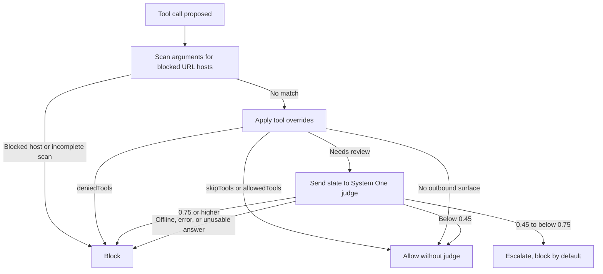

# What happens to a tool call?

oc-one-guard checks a proposed OpenCode tool call before it runs. It is a heuristic guardrail, not a network security boundary. This is the short GitHub-native version; the [HTML explainer](explainer.html) has a visual layout.

## The flow

If Mermaid does not render where you're reading this, here's the same flow in plain text:

1. OpenCode proposes a tool call. The plugin checks it in the `tool.execute.before` hook, before the tool runs.
2. The local blocked-host scan checks explicit URLs in argument strings and object keys. A matching host, or an incomplete scan, blocks the call before overrides or the judge.
3. Tool policy runs. `deniedTools` blocks; `skipTools` and `allowedTools` bypass the judge. A prefilter also allows calls with no detected outbound surface.
4. Calls still needing review go to the configured System One judge.
5. The result allows, escalates, or blocks the proposed call.

## What do the thresholds mean?

The defaults use the judge's deny probability as a decision cutoff. These are not calibrated probabilities.

- Below `0.45`: allow.
- From `0.45` up to (but not including) `0.75`: escalate. `escalateAction` defaults to `block`.
- `0.75` or higher: deny.
- Judge offline, request error or timeout, malformed response, or unclassifiable answer: block by default (`failMode` and `unknownMode`).

## Three example shapes

These are illustrative, not literal patterns the plugin guarantees to catch:

- A command posts `~/.aws/credentials` to an unfamiliar collector.
- A shell command pipes environment variables to an HTTP upload.
- A script is written first, then run later to send local files. Tracked staged-file contents can be included in the judge state.

The heuristics and judge can miss these, and can also flag legitimate work. No claim that every attack is caught.

## What should you keep in mind?

- The judge request is **not redacted**. It can contain rendered arguments and, in some cases, staged file contents. Use an endpoint you trust.
- The plugin cannot control arbitrary network activity from tools or child processes. Treat it as a guardrail, not a firewall or sandbox.
- This release targets OpenCode v1. Version `1.19.4` is the tested host; v2 is not supported.

For setup and details, see the [installation guide](installation.md), [configuration guide](configuration.md), and [security and data handling guide](security.md). The [HTML explainer](explainer.html) gives the longer visual walkthrough.
